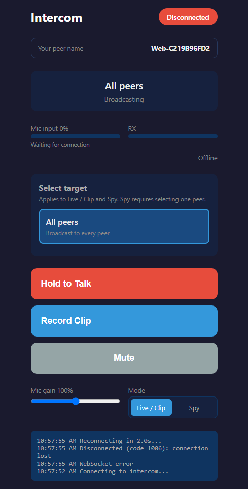
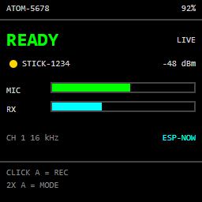

# AtomS3R Intercom (base station)

ESP-NOW intercom firmware for the **M5Stack AtomS3R + Atomic Voice Base
(K147)**. Pair it with the `StickS3-Intercom` project running on a StickS3.

## Features

- Live push-to-talk audio between boards (16 kHz mono, IMA ADPCM).
- Clip mode: record up to 15 s, then transmit it at 1x real time.
- Automatic peer discovery and online/offline indication.
- Works with any mix of StickS3 and AtomS3R units on the same ESP-NOW
  channel: multiple StickS3 units, multiple AtomS3R units, or a mix of both
  can share one intercom network. It is not limited to a single StickS3 and
  a single AtomS3R.
- Browser peers: when Wi-Fi is connected, the firmware serves a web client over
  HTTPS, so any phone, tablet or PC with a web browser and a microphone can
  join the intercom network as another peer.
- Transport flexibility: audio can travel over ESP-NOW or local Wi-Fi. A unit
  connected to Wi-Fi and a unit using only ESP-NOW can still communicate; the
  transport manager coordinates peers across both.
- Peer selection and monitoring: target `ALL` (broadcast) or individual peers;
  spy mode lets one peer listen through and record a clip on another peer's
  microphone; volume and mute controls are available.
- Compact 128x128 UI with peer name, mode, state, VU meter and battery.
- Audio buffers live in PSRAM; the UI sprite uses internal RAM.

## Hardware

| Item | Detail |
| --- | --- |
| Board | M5Stack AtomS3R + Atomic Voice Base (K147) |
| MCU | ESP32-S3-PICO-1-N8R8, 8 MB flash, 8 MB PSRAM |
| Codec | ES8311 (I2C `0x18`, I2S) |
| IO expander | PI4IOE (`0x43`) |
| I2C | SDA 38, SCL 39 |
| I2S | DIN 7, WS 6, DOUT 5, BCK 8 |
| Button | GPIO 41 (front button) |

M5Unified config used by the firmware:

```cpp
cfg.internal_mic = true;
cfg.internal_spk = false;
cfg.external_speaker.atomic_echo = true;
```

The Atomic Voice Base shares one I2S port between mic and speaker, so the
firmware stops playback while capturing. Incoming audio is buffered and played
after the button is released.

## Build and flash

Clone this repository with its shared-library submodule:

```sh
git clone --recurse-submodules https://github.com/Robot-icist/AtomS3R-Intercom.git
```

If it was cloned without submodules, run `git submodule update --init
--recursive` from the repository directory. Then, from this directory:

```powershell
C:\Users\Gille\.platformio\penv\Scripts\pio.exe run
C:\Users\Gille\.platformio\penv\Scripts\pio.exe run -t upload
```

Then build and flash `..\StickS3-Intercom` the same way.

## Controls

| Action | Result |
| --- | --- |
| Hold **BtnA** (Live mode) | Transmit while held; incoming audio plays on release. |
| Click **BtnA** (Clip mode) | Start recording; click again to stop and send. |
| Double-click **BtnA** | Toggle Live / Clip mode (cancels an active recording). |

## Web client



The firmware serves the web client over HTTPS on port 443 when Wi-Fi is
connected. See the shared library README for details.

## UI




- Header: device name and peer name (or `SEARCH`).
- Large state: `READY`, `RX`, `TALK`, `REC`, `SEND`, `ERROR`.
- Two VU bars: microphone and received audio.
- Footer: mode, battery, RSSI and a short hint.

## M5Burner (M5Stack community)

This repository ships the M5Burner firmware package layout:

- `m5burner.json` describes the `AtomS3R Intercom` category.
- `firmware_atoms3r_intercom/` contains the flash images named by address
  (`bootloader_0x1000.bin`, `partitions_0x8000.bin`,
  `firmware_0x10000.bin`, `littlefs_0x670000.bin`).

Build with PlatformIO first, then copy the generated `.bin` files from
`.pio/build/atoms3r_intercom/` into that folder before publishing. Run
`pio run -e atoms3r_intercom -t m5burner_push` to rebuild the filesystem image
and copy all four bins automatically.

## Troubleshooting

- **Peer stays `SEARCH`**: both boards must be on channel 1 and within range.
  Flash both projects; they use the same protocol version.
- **No sound on the AtomS3R**: check the Atomic Voice Base is seated and the
  ES8311 is detected at `0x18`.
- **Audio stutters**: keep the boards close; ESP-NOW throughput drops with
  distance. The jitter buffer tolerates short gaps.
- **Feedback/echo**: use Live mode as push-to-talk; do not place the two boards
  next to each other while both speakers are active.
